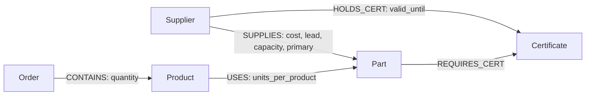
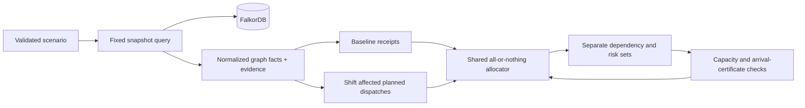
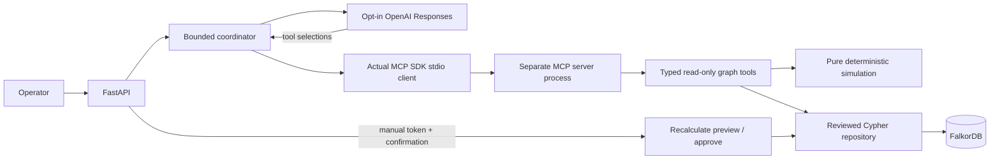
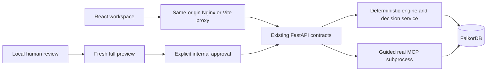

# RippleProof AI architecture — Phases 1–3

## Boundary and canonical state

FalkorDB is the only canonical domain datastore. All supplier, part, product,
order, certificate and relationship facts are read from it at request time.
`seed_data.py` is reproducible input to an explicit write command, never an
API data source. There is no seed or arbitrary-query route. Phase 3's only
write route stores authenticated internal decisions; operational facts remain
read-only through HTTP and MCP.
There is no JSON/SQL knowledge store or in-memory answer fallback.

FastAPI uses synchronous handlers so the synchronous official FalkorDB client
runs in its thread pool. Each operation owns its client/pool and Graph schema
object, avoiding shared mutable schema caches. Connections are lazy; app startup
does not require a working DB. Connection, socket and graph query timeouts are
bounded. Automatic transport retries are disabled. Pools close even if the
official client's constructor cannot connect.

The [official client](https://github.com/FalkorDB/falkordb-py) supports
`ro_query` and parameter dictionaries; all analysis queries use that read-only path.
The image's entrypoint appends its native `--dir` after `REDIS_ARGS`, so an
earlier `--dir /data` argument does not override it. The AOF-enabled named
volume is mounted at the actual `/var/lib/falkordb/data` directory, consistent
with the [official repository setup](https://github.com/FalkorDB/FalkorDB#step-1).
This was checked with both `CONFIG GET dir` and Docker mount inspection.

## Graph and evidence



Stable domain node IDs are stored in `id`. Relationships additionally have a
stable `id` property: `TYPE:source_id:target_id`, for example
`USES:PR-05:P-22`. Phase 1 permits one relationship of each modeled type
between each endpoint pair. These identities survive reseeding and do not rely
on internal FalkorDB numeric IDs, which can be reused. The repository obtains
full nodes, edges and paths from the official graph result parser.

`EvidenceNode` and `EvidenceRelationship` retain stored properties. The evidence
serializer checks source and target against the actual returned edge endpoints.
It generates the readable path from those graph objects, including reverse
arrows where traversal follows an incoming relationship. No narrative evidence
is keyed to a scenario ID in runtime code.

`Decision`/`Evidence` are never seeded. They appear as zero counts in the Phase 1/2
baseline and are written only by the Phase 3 manual internal-approval path.

## Reviewed Cypher

The executable allowlist is `rippleproof/queries.py`. No label, relationship
type, expression or query text comes from HTTP input. All supplied IDs are
validated and passed through the client's `params` argument.

The dependency expansion returns a path from this same query:

```cypher
MATCH evidence = (supplier:Supplier {id: $supplier_id})
  -[:SUPPLIES {is_primary: true}]->(part:Part)
  <-[:USES]-(product:Product)<-[:CONTAINS]-(purchase_order:Order)
WHERE purchase_order.status = $order_status
RETURN evidence
ORDER BY purchase_order.id, part.id, product.id
```

This identifies open-order dependencies through primary supply only. An order
can produce multiple paths through different products or parts; `order_ids`
deduplicates the identifiers. Order quantity × units per product is the demand
on each individual path, not a stock allocation or aggregate shortage forecast.

Alternatives are non-primary `SUPPLIES` relationships. One query retrieves each
candidate's supply terms and **all actual certificate holdings** with an optional
match so candidates with no holdings remain present. A separate fixed query
retrieves the specified part's `REQUIRES_CERT` relationships. Deterministic code
joins these returned facts by certificate ID and evaluates expiry against the
explicit `as_of` date. Missing holdings remain `null`; expired holdings retain
their stored expiry and relationship evidence. No external compliance assertion
is made. Supplier status is exposed as stored, not used as a feasibility filter.

Summary queries group node label arrays and relationship types. Their results
are combined with zero defaults for modeled labels/types. `GRAPH.LIST` confirms
the module is available and identifies an unseeded graph without creating one.
Plain Redis without the graph module fails readiness. Health returns 200 for a
working server with an unseeded graph and reports `graph_exists: false`.

## Seed semantics

The fixed reference date is **2026-10-15**, with PRNG seed `20261015`.
The generated input has 63 nodes and 127 relationships. Both explicit seed runs,
the real HTTP summary, and independent database queries returned those counts.

Each label/type has its own static `UNWIND $rows` write template. Node merges
use stable IDs. Edge merges use bound endpoints and type; `id` is then set from
the seed. `SET n = row` / `SET r = row.properties` restores the seeded property
maps on repeat runs. These semantics follow FalkorDB's documented
[MERGE](https://docs.falkordb.com/cypher/merge) and
[SET map replacement](https://docs.falkordb.com/cypher/set) clauses.

Seeding restores the synthetic fixture's properties and should run before demo
traffic. It does not delete unrelated graph entities. Batches are separate
queries, so the complete seed is not one transaction; rerunning repairs an
interrupted seed. No automatic seed runs during API startup. Phase 1 is a small
graph; indexes and production-scale pagination have not been introduced.

## Security, failure behavior and limits

- Published ports bind to `127.0.0.1`; no browser/admin UI is published.
- Backend runs as UID 10001, with a read-only filesystem, temporary `/tmp`,
  dropped capabilities and `no-new-privileges`.
- Pinned runtime/dev requirements are separate. Docker's Python base is 3.12.
  The required FalkorDB `latest` tag and Python `3.12-slim` tag can change;
  image-level bit reproducibility is not claimed.
- Network failure becomes 503; graph command/evidence failure becomes a logged,
  sanitized 500. Readiness returns 503 for either. Invalid HTTP inputs become
  422; missing entities become 404. Empty results remain honest empty results.
- Tests reserve an unlistened local TCP port to verify an actual connection
  failure. Live integration fixtures use temporary `test_rippleproof_*` graphs,
  not the demo graph, and never substitute a mock DB.
- Legacy Phase 1 views make several reads within an operation, without a
  transaction across them. Avoid seeding or external mutation while reading
  these views. The Phase 2 route uses one coherent graph snapshot command;
  its scope and simulation assumptions are described below. Neither phase
  exposes write HTTP endpoints or real procurement actions.

The historical Phase 1 verification passed all 11 real-server integration tests
and its complete 47-test suite.
Controlled database-outage checks returned 503 for all four data/readiness
routes. A full graph fingerprint remained unchanged across restart, migration
to the corrected volume mount, and container recreation without reseeding.
The empty-graph test uses a persisted create/delete sequence so temporary
graph cleanup also replays correctly from AOF on the tested release.
See the separate verification record for exact commands and observed outputs.

## Phase 2 simulation boundary

`POST /api/scenarios/simulate` accepts a validated supplier, explicit as-of date,
exclusive outage window, and optional mitigation flag. The repository returns
a single coherent read of the live graph. `simulation/snapshot.py` validates and
normalizes facts, `simulation/models.py` defines typed contracts, and the pure
functions in `simulation/engine.py` perform every allocation and calculation.
No fixture module is imported by this API path. Scenario IDs derive from the
request, normalized graph fingerprint and engine version; no wall clock enters
the result. A graph value changing changes the snapshot and result.



### Demand, ordering and conservation

Open order-line quantity is multiplied by each actual BOM edge's
`units_per_product`. Repeated parts across products are summed within the order,
while the individual two-edge BOM paths remain in the response. Orders sort by
deadline ascending, numeric priority descending, then lexical ID.

For each part the allocator maintains receipt lots with source ID, arrival,
quantity and evidence references. Initial stock arrives at `as_of`. Lots are
consumed oldest-arrival first, with stable ID tie-breaking. An order first
checks its entire BOM against unreserved units arriving on/before its deadline.
Only a fully covered order commits reservations; failed orders consume nothing.
Each lot exposes received = allocated + remaining. Per-order results distinguish
available, actually allocated and missing quantities, plus late receipts that
explain shortfalls. This prevents shared inventory from being reused per order.

This is **materials-only on-time feasibility**. Stored production days, factory
capacity, transport operations and real delivery promises are not scheduled.
An on-time classification means the modeled complete material requirement can
be covered by the customer deadline under these explicit assumptions.

### Baseline and disruption

Both plans use the same stock and allocator. A `PLANNED` dispatch inside
`[outage_start, outage_end_exclusive)` moves to the end, with the original
dispatch-to-arrival interval preserved. Already dispatched stock is not
cancelled; cancelled receipts contribute nothing. Initial on-hand inventory
remains available. Existing backlog dispatch smoothing is outside this model.
Past-due planned receipts, past arrivals that could already be in on-hand stock,
future-dated dispatched facts and invalid shipment data are marked unresolved
rather than counted twice or silently fabricated.

`newly_at_risk_orders` is exactly disrupted-at-risk minus baseline-at-risk.
Dependency paths are independent of this classification. Because failed orders
release all material reservations, a disruption can indirectly improve another
order's coverage. In the actual demo, O-122 is baseline-at-risk but becomes
covered when O-106 fails, so it is correctly excluded from newly-at-risk orders.

### Alternative scheduling and deterministic ranking

The planner evaluates real, non-primary supplier-to-part offers. It excludes
the disrupted supplier and inactive suppliers, requires complete terms, and
starts new shipping no earlier than `as_of`. Daily capacity is per supplier and
part; existing non-cancelled dispatches and other proposed units reserve that
day's capacity. New arrivals are dispatch plus the offer's lead days.

All part-required certificates must be held and remain valid on each proposed
arrival date, inclusive. Missing, expired and unknown holdings produce explicit
reason codes and graph references. Supplier qualification is part-specific:
S-10 fails P-22's C-02 requirement, while its valid C-01 permits supplying P-12.

For each policy, the planner tries to restore newly-at-risk orders in the same
stable order. An attempted purchase is atomic across the complete BOM and
multiple shipping days. Candidate proposals are re-evaluated using the same
global allocator; they must preserve already covered disrupted orders and
increase the restored set. Unused proposed units are removed and re-evaluated.

Policies are mixed cost-first, mixed lead-first, and each single supplier.
Rank by restored newly-at-risk order count descending, unused additional units
ascending, gross additional cost ascending, then supplier IDs and policy ID.
This is a greedy heuristic, **not a globally optimal purchasing plan**. The
additional-procurement horizon is 366 calendar days; existing commitments may
arrive later. Malformed/vital missing data produces `incomplete_data` and
per-order `insufficient_data` rather than infinite stock or capacity.

All price calculations use Decimal, initialized from graph value text. Each new
shipment is priced as quantity × unit cost and rounded to two decimals using
ROUND_HALF_UP; totals use a 50-digit Decimal context. JSON costs and prices are
strings. Existing purchase commitments, cancellations, taxes, labor and transport
are excluded from `estimated_additional_procurement_cost`.

### Persistence, compatibility and limits

`inbound_data.py` is explicit synthetic migration input, used only by
`python -m rippleproof.migrate`. The migration adds missing graph facts and
preserves every existing node, relationship and property. The Phase 1 base
seed retains its original fixture-restoration semantics and should only be
used for fresh demo graphs or isolated tests, not as an upgrade command.

The new route remains read-only. It persists neither proposals nor decisions.
All existing routes remain available; summary counts intentionally grow after
the additive migration. The original 47 tests remain in the 103-test suite,
with OpenAPI's exact route set extended for the new POST and the outage test
extended to cover it. No original data count assertion was weakened: Phase 1
fixtures remain 63/127, and migrated fixtures assert 145/291 explicitly.

Validated graph integer inputs are limited to 0..1e9 (positive where required),
prices to 0..1e12, and request outage boundaries to 366 days around `as_of`.
Missing requirement edges need an explicit `certification_policy='none'` before
the engine can assume a part has no certification requirements. Schedule
exhaustiveness is a disclosed model assumption, not an audited external fact.

Live graph reads are coherent within one snapshot command. Concurrent CLI
migrations/external writers should still be serialized. There is no large-graph
pagination, production optimization, stock history reconstruction, enterprise
integration, LLM tool calling, MCP or approval workflow in Phase 2.
See [PHASE2_VERIFICATION.md](PHASE2_VERIFICATION.md) for actual results and evidence.

## Phase 3 operational revision and actual MCP boundary

`GraphSnapshot.fingerprint` now explicitly means **operational fingerprint**.
Only Supplier, Part, Product, Order, Certificate, InboundShipment and SUPPLIES,
USES, CONTAINS, REQUIRES_CERT, HOLDS_CERT, FULFILLS, FOR_PART participate.
Memory is excluded before normalization/validation as well as hashing. The live
repository obtains those facts in one coherent, fixed read query, bounded at
2,000 nodes / 4,000 relationships. Overflow is an explicit failure, not a partial
simulation. MCP/approval snapshots also have a 2 MB normalized byte budget.
The physical summary separately counts all memory facts.

The valid operational serialization and `phase2-materials-v1` scenario identity
algorithm remain unchanged. Existing clean Phase 2 snapshots keep their exact
fingerprint and scenario ID. Writing memory no longer changes either. Existing
scenario IDs previously derived from graphs already containing memory need a
fresh preview; no prior live decisions existed in the reference graph. There is
no automatic destructive migration and no hash cache.



The pinned official `mcp==2.3.0` SDK supplies both sides of the JSON-RPC stdio
transport. `mcp_server.py` registers typed schemas from strict Pydantic models
using its supported low-level Server API. `mcp_client.py` launches only the fixed
Python server module, initializes the session, enumerates tools and invokes
`tools/call`. No arbitrary executable or MCP server URL comes from HTTP/model
input. The child receives graph settings, not model credentials or approval
headers. The six tools and payload/pagination rules are listed in README.

`tools.py` produces compact scenario facts, preserves all critical risk/order,
cost, shipment and certification fields, and offers paged dependency evidence.
This avoids the prior ~924 KB full Phase 2 response in model context. Oversized
results are rejected; truncation has explicit counts and drill-down instructions.
Graph property text is untrusted data. `resolve_evidence` returns stored source
properties or paged archived snapshot facts, without executing their content.

## Bounded provider orchestration and fact integrity

`provider.py` is one small provider abstraction using the pinned HTTP transport
and official Responses protocol. Model name, credential and explicit paid-call
opt-in must be supplied by the operator. Defaults disable all remote calls.
The endpoint is fixed, environment proxies and retries are disabled, each model
request has a 20-second default timeout, response bytes are capped at 64 KiB,
and output tokens at 1,200. Full runs default to 90 seconds, six model turns,
eight tool calls and 128 KiB of accumulated input. MCP calls have 12-second
timeouts. SDK task-group errors are collapsed without losing their original
bounded-operation or cancellation meaning.

The model receives natural-language intent plus the explicitly supplied validated
scenario. Missing scenario fields cause a clarification response before any
model call. Tool names/arguments are allowlisted and schema-validated; simulation
arguments must equal the operator's scenario. Source fingerprints must agree
between tools, or the run fails visibly. Structured simulation output is also
validated by the client, including scenario ID derivation from its actual request
and fingerprint. No model-selected approval tool exists.

The model's final schema can select only a scenario and returned evidence refs.
It cannot author authoritative quantitative text. The application renders the
answer from actual simulation facts. Extra invented cost, quantity or compliance
fields, unknown evidence and wrong scenario IDs produce a visible safe fallback
using the already verified facts. A model that never obtains a scenario result
cannot produce a successful answer. Public traces contain tool name, validated
arguments, timestamps, status, bounded evidence refs, byte count and output hash;
they contain no model reasoning, raw provider content or secrets.

Guided mode has a fixed, explicitly labeled MCP walkthrough and zero model calls.
It never silently substitutes for requested agent mode. CI uses a named mock
provider and a mock HTTP transport driving real MCP calls; these prove protocol
and coordinator behavior, **not** real-provider acceptance. That gate requires
an operator-authorized call, credentials and a captured live trace.

## Internal decision preview, approval and graph memory

The pure simulator can evaluate a chosen existing policy as well as its default
ranked selection. Phase 2's default response and identity semantics are unchanged.
`decisions.py` re-evaluates that policy from fresh graph facts and hashes a complete
preview into `plan_revision`. Clients choose a policy identifier; no authoritative
quantity, price or evidence property is accepted in approval input. Missing vital
facts prevent preparation/approval. Preparing does not write any node.

Approval requires a configured random secret (32+ characters), constant-time
Bearer-token comparison, literal boolean human confirmation, a demo operator
pseudonym, rationale, idempotency key, expected scenario ID, operational hash and
plan revision. Relevant source changes or changed plans return 409. Stable
decision identity derives from the selected graph and idempotency key; the full
request digest distinguishes replay from conflict. An existing same-request
decision is returned before recalculation, preserving retry semantics after
later source changes and process restarts.

One reviewed parameterized write stores Decision, one Evidence snapshot and all
SUPPORTED_BY, SELECTS, AFFECTS and REFERENCES edges. It checks complete source
node matching and archive-ID collision **before any write**. The archived JSON
properties contain the complete typed operational node/edge facts, including
edge endpoints and properties. REFERENCES links the archive to the actual 145
source nodes in the reference graph; relationship identities/properties are
captured in that archive. These are archival evidence, never supplier entities.
The plan revision, computed quantities, arrival certifications, cost, rationale,
limitations, operator pseudonym and UTC decision timestamp are durable graph
properties. JSON is stored **inside FalkorDB**, not in a parallel domain store.

The single-worker API holds a process-wide lock across replay lookup, source
check, recomputation and graph write. Tested same-key concurrency produces one
decision. The write builds the complete topology in one server command, with
tested precondition failures leaving no partial decision. This is **not an
atomic source-hash compare-and-write transaction**: direct Redis clients, CLI
migrations or another backend process could alter operational facts between the
read and write. The localhost demo must run one worker (explicit in Docker) and
serialize external writers. A public/multi-writer deployment requires a tested
server-side revision guard, operator authentication and rate controls.

An internal approval does not mutate stock, shipments or customer order status,
contact a supplier, reserve real capacity or spend money. Live operational graph
verification remains read-only; synthetic confirmation tests and durable restart
proof use an explicitly isolated audit graph. See
[PHASE3_VERIFICATION.md](PHASE3_VERIFICATION.md) for actual results and limits.

## Phase 4: evidence-first browser workspace

`frontend/` adds React 19, strict TypeScript, Vite, TanStack Query, Zod,
Cytoscape.js and Lucide. `App.tsx` owns the volatile scenario draft, completed
analysis, selected path/part, source inspection and hash-based navigation.
Feature modules separate overview, simulation, evidence, guided tools and
decision memory. Shared accessible controls and CSS tokens provide the dark
industrial visual system without a large UI framework or external font assets.



`scripts/generate-contracts.mjs` reads the actual OpenAPI and emits 41 Zod
validators with inferred TS types. Runtime validates every successful HTTP
response. History is explicitly validated against its source and real paged
responses because its existing route has no response model. The browser HTTP
boundary caps responses at 6 MiB, bounds requests, supports aborts and does not
echo arbitrary backend validation inputs. Only transient GETs retry once;
simulation, guided tools, previews and approvals require explicit retry.
No fake runtime data or parallel knowledge store is introduced. Decimal money
is formatted as text without recomputing or rounding costs with binary floats.

Live health/summary polling drives availability; a failed graph check removes
the current simulation. Input changes cancel calculations and discard old
outcomes. An independent simulation POST supplies comparison sets, quantities,
proposed receipts and arrival-date certificate checks. Dependency reachability
is displayed separately from material risk. The engine-selected comparison is
identified explicitly; an alternative policy requests a fresh server preview.

Evidence uses one returned path at a time, including real node IDs, edge IDs,
direction and properties. Cytoscape is lazy-loaded. Search, status filtering,
fit/reset, three-row pagination and source-reference buttons bound rendering and
support keyboard use. Selecting a path updates the material scope. Desktop has
three columns, tablet uses a two-column workspace and inspector drawer, and
mobile places compact comparison before a vertical chain and expandable
constraints. Tables scroll inside named regions; they never widen the page.

Guided mode sends only `mode: guided` and verifies returned mode and zero model
requests. The UI shows the actual ordered MCP trace after completion, including
arguments, timestamps, output byte counts/hashes and evidence. It never animates
fabricated tool selection or presents guided mode as autonomous AI. This UI does
not automatically invoke an agent. Phase 5A adds the explicit capability gate
described below.

Decision review first requests the full authoritative preview. An acknowledgement
unlocks a separate manual form with operator pseudonym, rationale, transient
password and typed `APPROVE INTERNAL`. The token remains in an uncontrolled DOM
input/ref until that attempt, then is cleared before awaiting the request. It
never enters React value state, Query caches, URLs, browser storage or logs.
Exact-intent network retries retain the idempotency key; edited intent gets a
new key. A 409 clears all approval inputs, removes the previous analysis and
recalculates the preview for manual re-review. After successful persistence,
the UI checks the scenario ID and operational hash again. Ledger records remain
historical until their current source is explicitly checked. These controls do
not provide production authentication, secure memory erasure, or cross-writer
transaction isolation. Non-loopback browser approval is disabled.

The frontend container runs unprivileged with a read-only filesystem and /tmp
tmpfs. Local ports and database volumes are unchanged; web binds only
127.0.0.1:18080. Nginx uses Compose DNS re-resolution, bounded proxy timeouts,
no-store API responses, self-only connection/script policy and framing denial.
Inline styles are permitted for React coverage bars and Cytoscape rendering.
No credentials or provider configuration are passed into the frontend build.
The static health endpoint proves web availability only; UI backend health
always comes from the real `/health` API.

One pre-existing HTTP defect was corrected: strict MCP pagination integers
rejected URL query strings. `DecisionHistoryQuery` converts only ASCII decimal
query strings before inherited strict bounds validation. `HistoryInput` remains
strict for JSON/MCP. No endpoint, engine or graph schema was added or renamed.
Two real-server regression tests verify pagination and invalid query rejection.

`scripts/phase4_test_backend.py` creates a new synthetic audit graph and runs the
same FastAPI app on a separate localhost port. Only the local test runner reads
its private credential/control files. Controls never become product endpoints.
Browser tests exercise successful internal persistence, a lost HTTP response
after actual commit, replay, source staleness, disabled approval, empty graph,
real refused database connection and process restart. Test graphs are retained;
the live graph remains untouched. See [Phase 4 verification](PHASE4_VERIFICATION.md)
for actual test outcomes, screenshots and remaining human acceptance steps.

## Phase 5A release preparation

`GET /api/agent/capabilities` is a typed, no-store configuration read, requiring
no graph or remote provider request. It exposes no keys. Disabled/incomplete
provider settings fail closed. The UI separately validates capabilities, explicit
intent and current health before one agent attempt; it blocks duplicates and
automatic retries. Actual returned mode, request bounds, successful simulation,
scenario and source revision are checked. A test-injected provider is identified
as a controlled model simulator, not remote LLM evidence. Guided mode remains
the separately labeled, zero-model no-key path. See [agent gate](AGENT_DEMO_GATE.md)
for resource bounds, cancellation limits and the unimplemented monetary quota.

This phase changes no material formulas, graph schema, migrations or approval
protocol. The existing tested database image is pinned by digest. Backend and
frontend are rebuilt without recreating the live database. An independent source
export is installed under a unique Compose project with its own empty volume,
graph and localhost ports. Only that fresh graph is seeded. Isolated database
outage verifies that impact, simulation and MCP cannot answer without FalkorDB.

The candidate exporter uses explicit source selection, content/history scanning,
document-only path sanitization and a second archive-member audit. Workstation
state, Git metadata, backups, keys and dependency directories stay outside it.
Third-party license texts are retained separately from project All Rights
Reserved policy. No export is published automatically. See
[Phase 5A verification](PHASE5A_VERIFICATION.md) for executed evidence and limits.

## Phase 5B-1 provider metadata

`telemetry.py` defines strict response-only metadata models and a context-local,
eight-record collector per agent invocation. `OpenAIProvider.complete` still
returns only output items; the coordinator attaches optional `provider_telemetry`
after execution. Guided/custom controlled providers leave it null. Metadata never
enters MCP, model context or FalkorDB. Existing model/tool/time/byte bounds remain.

The provider records observed response/request/model identifiers, known provider
status, actual HTTP status, monotonic duration and validated reported token
counters in a finally block. Cancellation propagates after record finalization;
run timeouts retain partial telemetry. An explicit Python collector argument lets
an authorized caller inspect cancellation evidence even when no HTTP response can
be delivered. This is memory-local, not durable crash/billing storage.

Only allowlisted identifier shapes and fixed local error classifications survive.
Known keys and sensitive input values are rejected from identifier fields; raw
headers/bodies/errors, prompts and credentials are never retained. Unknown or
invalid usage is null. Complete aggregate usage is available only when every
record reports consistent counters; observed partial sums remain separately
labeled. No missing counter, provider identity or request ID is invented.

The final selection Literal is sent as an equivalent single-value enum, matching
the documented strict JSON Schema subset. Pydantic validation remains unchanged.
Stateless requests include encrypted reasoning for in-memory tool-turn replay;
neither that opaque content nor reasoning text is added to telemetry or artifacts.
The optional API field is reflected in generated frontend validators; no UI
redesign is introduced. See [Phase 5B-1 verification](PHASE5B1_VERIFICATION.md).
