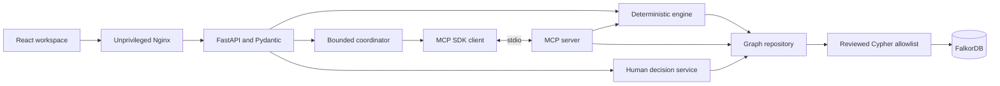

# Architecture

RippleProof separates graph facts, deterministic planning, bounded tool selection
and human-approved memory. FalkorDB is the sole canonical domain store. Neither
the browser nor a model can author authoritative quantities, prices or compliance.

## Request and data boundaries

The optional Responses provider supplies constrained tool/final selections to
the coordinator. Guided mode runs a fixed MCP sequence with zero model calls.
Remote provider acceptance is unverified. See [security](SECURITY.md).

| Implementation | Responsibility |
| --- | --- |
| [app.py](../rippleproof/app.py), config/models/errors | Strict HTTP validation, limits, health and sanitized failures |
| [repository.py](../rippleproof/repository.py), [queries.py](../rippleproof/queries.py) | Official FalkorDB client, parameterized reads and guarded writes |
| [service.py](../rippleproof/service.py), [evidence.py](../rippleproof/evidence.py) | Dependency/alternative views and connected source serialization |
| [simulation/](../rippleproof/simulation/) | Typed coherent snapshot, shared allocator, alternative scheduling and Decimal costs |
| [tools.py](../rippleproof/tools.py), MCP client/server | Six typed read-only tools and genuine SDK stdio transport |
| [agent.py](../rippleproof/agent.py), [provider.py](../rippleproof/provider.py), [telemetry.py](../rippleproof/telemetry.py) | Bounded orchestration, Responses transport and redacted response-only metadata |
| [decisions.py](../rippleproof/decisions.py) | Recalculated preview, human approval, revision checks and replay |
| [frontend/src/](../frontend/src/) | React/TypeScript, TanStack Query, Zod, Cytoscape and accessible controls |

Graph connections are lazy and operation-scoped; the synchronous official client
runs in FastAPI's handler thread pool. Pool/schema objects are not shared.
Connection, socket and graph-query timeouts are bounded; retries are disabled.
Read paths use `GRAPH.RO_QUERY`. No query expression, label, executable, MCP URL
or server command is accepted from a model or HTTP caller.

## Coherent graph facts and evidence

The [graph model](GRAPH_MODEL.md) defines stable node and edge IDs. Relationships
use `TYPE:source_id:target_id`, independent of reusable database-internal IDs.
Paths retain actual endpoints/direction/properties from the same query. A query
can traverse an incoming edge without reversing its stored direction.

Full simulation reads one coherent snapshot. MCP/approval use a fixed operational
label/type query bounded at 2,000 nodes and 4,000 edges, plus a 2 MB normalized
snapshot budget. Sentinel overflow fails explicitly. Only operational facts enter
the fingerprint; Decision/Evidence writes leave scenario identity unchanged.
Changing a relevant source property invalidates the preview. There is no persistent
JSON/SQL knowledge store, cached answer or graph-down fixture fallback.

## Deterministic material planning

1. **Demand:** order-line quantity × each BOM coefficient, summed per shared part;
   individual graph paths remain available as evidence.
2. **Priority:** deadline ascending, numeric priority descending, stable order ID.
3. **Conservation:** lots are allocated oldest-arrival first. An order commits
   inventory/receipt reservations only when its complete BOM is covered. Failed
   orders consume nothing; received = allocated + remaining for each lot.
4. **Outage:** a PLANNED dispatch in `[start, end_exclusive)` moves to the end,
   preserving its stored transit interval. Dispatched and cancelled lots remain
   distinct. Invalid/past-due facts remain unresolved rather than counted twice.
5. **Alternatives:** actual non-primary offers, active supplier, booked per-part
   daily capacity, lead days and all required certificates valid through arrival,
   inclusive. New dispatches start no earlier than the scenario as-of date.
6. **Comparison:** newly at risk = disrupted risk minus baseline risk. Recovery
   proposals must preserve covered disrupted orders and restore additional ones.
   Shared-material reallocation can also resolve a baseline shortfall.

Policies compare mixed cost-first, mixed lead-first and single suppliers. Ranking
uses restored newly-at-risk count, unused proposed units, cost, supplier IDs and
policy ID. This bounded greedy heuristic is not globally optimal. The additional
proposal horizon is 366 days. Vital missing data yields explicit incomplete/
insufficient-data results, never unlimited capacity or assumed certification.

Decimal multiplies each proposed quantity by unit price and rounds each shipment
to two decimals with ROUND_HALF_UP in a 50-digit context. API money is string
data. Gross additional procurement excludes committed spending, cancellation
fees, taxes, transport and labor. Material coverage does not schedule factories
or promise real delivery. See [executable query/algorithm explanations](CYPHER_AND_EVIDENCE.md).

## MCP and bounded orchestration

The official MCP SDK implements both sides of stdio JSON-RPC. The client spawns
only `python -m rippleproof.mcp_server`, supplies graph settings, initializes the
session and invokes reviewed tools. Model keys/approval tokens are not passed
to this subprocess. Tool schemas and arguments are strict; results are bounded,
paged where appropriate, and carry real source references.

The coordinator requires an explicit validated scenario, enforces matching
simulation arguments/revisions and validates selected references. Final output
is rendered from verified tool facts. Invented quantities/prices/certifications,
unknown references or mismatched scenarios fail visibly. Guided execution never
silently substitutes for a requested real-agent run.

Provider telemetry is request-local, bounded to eight records and derived only
from actual provider response/request metadata. Unknown usage remains null;
complete totals and observed partial sums are distinct. Raw prompts, bodies,
headers, errors, encrypted reasoning and secrets are excluded. Cancellation
finalizes collected metadata; process crashes are not durable billing records.
Mocked transport tests are not remote model evidence.

## Human review and memory

Preparing a plan re-evaluates the chosen policy from fresh graph facts and hashes
the complete preview. Approval requires a separate secret, literal human
confirmation, pseudonym/rationale, idempotency key and expected scenario,
operational fingerprint and plan revision. Changed intent/source conflicts;
same-key/same-request retries return the original record, even after later changes.

One parameterized command stores Decision, Evidence and source links after
checking source completeness and archive collision. Archived snapshot JSON lives
inside FalkorDB. A process lock serializes approval in one worker, but it is not
a server-side source-hash compare-and-write transaction against external writers.
No real stock, order state, capacity booking or procurement is changed.

## Browser and deployment

The frontend validates successful API responses with generated Zod contracts.
Requests are bounded/cancellable, stale analysis is discarded, transient GETs
retry once and mutations require explicit intent. Currency formatting preserves
Decimal strings. Cytoscape lazy-loads connected evidence; tablet uses an inspector
drawer and mobile a vertical chain. Source controls support keyboard navigation.

Approval uses a transient uncontrolled password field, cleared per attempt and
navigation. It is not included in React/query state, browser storage, URLs or
traces. Non-loopback browser approval is disabled. This is demo authorization,
not a production identity service or secure memory-erasure guarantee.

Images are digest-pinned. Backend/frontend run unprivileged with read-only
filesystems, temporary storage and dropped capabilities. Nginx uses same-origin
proxying, no-store API responses and Compose DNS re-resolution. All host ports
bind to loopback. FalkorDB AOF persists at `/var/lib/falkordb/data` in `graph-data`.
Seed/migration are explicit CLIs; no application startup seeds a graph.

## Failure and verification

Strict malformed input returns 422; missing entities 404; stale/conflicting
approval 409; token rejection 401; unavailable DB/configuration 503. Graph/evidence
failures are sanitized. Bounded agent/provider errors remain explicit. Health
reports an absent graph without creating it.

[Testing](TESTING.md) covers real isolated FalkorDB, fingerprint/memory regressions,
mocked provider failures/cancellation, real MCP, browser approvals/replay/outages,
responsive accessibility and a source-only isolated Docker installation. All
historical implementation/evidence remain in Git history and local archives.
