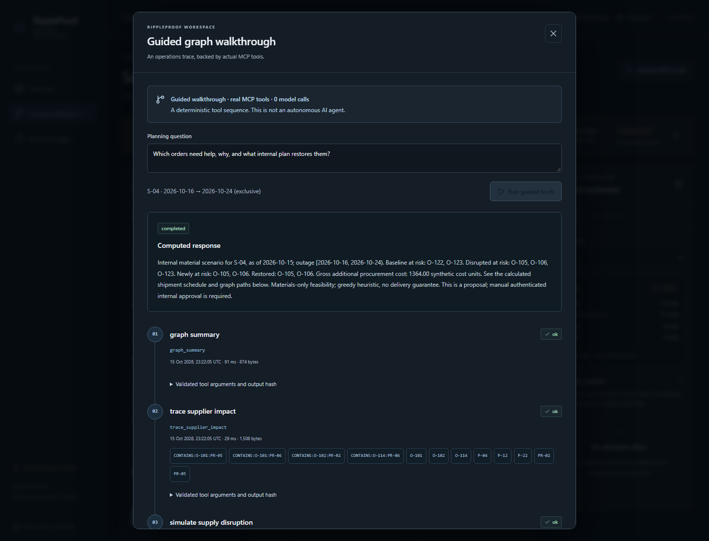

# Demonstration walkthrough

[Watch the authentic three-minute English-captioned video](https://youtu.be/ttOWMdWxIPU).
The recorded application is local and synthetic; Guided MCP is deterministic,
uses real SDK tools/FalkorDB, and makes zero remote model requests. Remote LLM
acceptance has not been verified. No live approval or purchase is demonstrated.

1. Start the [local application](../README.md#run-locally-with-docker). Preserve
   existing graph data; seed/migrate only a fresh empty demo graph.
2. Open Scenario Workbench. Use S-04, as-of 2026-10-15, outage `[2026-10-16,
   2026-10-24)`, mitigation enabled, then **Run scenario**.
3. Select O-101. Follow `S-04 → P-22 ← PR-05 ← O-101` and inspect actual edges.
   Demand is 8 products × 4 part units = 32. It remains materially covered.
4. Compare baseline/disrupted/mitigated coverage: **19 / 18 / 20** of 21 open
   orders. O-105/O-106 become newly at risk and are restored. The four proposed
   shipments total 132 units and **1,364.00 synthetic additional cost units**.
5. Inspect P-22: S-09 holds C-01/C-02 valid on arrival; S-10 lacks C-02. Switch
   to P-12, where S-10's C-01 can qualify. Eligibility is part/arrival-specific.
6. Open **Guided MCP tools**, explicitly run it, and inspect all four completed
   tool steps. The real-agent control remains separately capability-gated.
7. Open **Review internal plan**. Inspect the full schedule, certifications,
   cost and revisions; close without approval. An empty live ledger is expected.

The screenshot is an unchanged authentic capture from the local application.
Isolated automated persistence tests are described in [testing](TESTING.md);
they are not human approvals. [Security](SECURITY.md) explains token isolation,
model limits and the one-worker/external-writer boundary. Nothing contacts a
supplier, places a purchase or reserves real stock/capacity.
