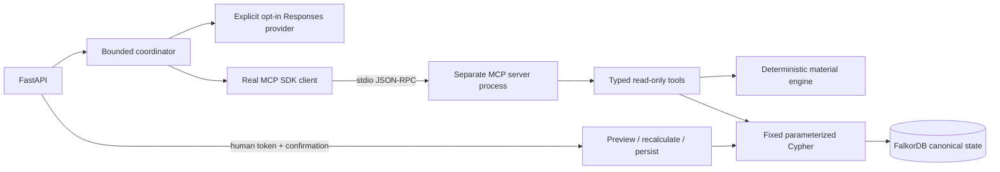

# Phase 3 verification — 2026-10-15

Phase 3A, MCP transport, bounded coordinator and internal-approval implementation
are complete and exercised locally. **Real remote LLM acceptance remains pending:**
no paid provider call was authorized or executed. The genuine OpenAI Responses
integration is tested through a controlled HTTP transport driving actual MCP
and FalkorDB. Guided mode is expressly labeled and makes zero model calls.

No live operational facts were overwritten, no base seed was run against the
existing graph, no volume or backup was deleted, and no GitHub push, real purchase,
supplier contact, frontend or Phase 4 work occurred. Work remained on `main`.
There are no commits or configured remote in this local repository.

## Baseline protection and fingerprint regression

Before implementation, the existing suite returned **103 passed in 6.78s**.
Both services were healthy. The live `rippleproof` graph had 145 nodes and
291 relationships, including 82 InboundShipment nodes. A fresh ignored backup
was created at `.local/backups/phase3-baseline-20261015.json`; earlier backups
and historical verification records were preserved.

The first implementation change excludes memory from operational normalization
and hashing. Its first real-FalkorDB run returned **7 passed in 2.17s**:

- Inserting Decision, Evidence and SUPPORTED_BY leaves the **entire simulation
  response**, operational fingerprint and scenario ID unchanged.
- Changing stock, supplier status, offer cost, order deadline, certificate expiry
  or shipment timing changes both fingerprint and scenario ID. All six mutations
  are performed against isolated real FalkorDB graphs.

The operational labels are Supplier, Part, Product, Order, Certificate and
InboundShipment. Operational relationships are SUPPLIES, USES, CONTAINS,
REQUIRES_CERT, HOLDS_CERT, FULFILLS and FOR_PART. Memory is filtered **before**
validation so malformed memory cannot invent material data issues.

The serialization and scenario identity algorithm remain compatible with the
clean Phase 2 graph. The actual unchanged values are:

```text
operational fingerprint:
d3c35628f3c00ce059907dfbe57a6acfa639d5b95f931b650a7faeb55abee19e
scenario ID: SC-4990e7e493adea7efa18
```

The full live Phase 2 response was compared for JSON equality with the historical
captured response, and **matched exactly**. Every original node/edge property
also matched the pre-Phase-3 backup. Summary counts stayed 145/291. The physical
summary now includes a zero-valued REFERENCES type until approvals are stored.
Graphs that already contained memory under the old buggy hash need a new preview;
there were no live decisions to migrate. No destructive migration is provided.

## Implementation and architecture



The official SDK is pinned to `mcp==2.3.0` / `mcp-types==2.3.0`; all new runtime
and transitive dependencies are pinned. The server uses the supported low-level
Server constructor, strict Pydantic input/output schemas and real stdio transport.
The provider uses one fixed OpenAI Responses endpoint, no retries, bounded response
size and `store:false`. All deterministic math remains in the existing engine.
Its default behavior is unchanged; a chosen policy can additionally be evaluated
to prepare an authoritative alternative-plan preview.

The coordinator bounds turns, calls, wall time and context. It rejects forbidden
tools and altered operator scenarios. Each result is graph-backed, compact and
source-revision checked. The model's final output can select a scenario and
real citations; it cannot supply authoritative prices, quantities, discounts or
certificate status. Extra invented fields or citations cause an explicit safe
fallback containing only the already verified simulation facts. A model that
never obtains a scenario result cannot return a successful analysis.

Defaults: six model turns, eight tool calls, 90-second run, 20-second model
request, 12-second MCP request, 64 KiB provider response, 128 KiB accumulated
input, 1,200 output tokens. Operational snapshots cap at 2,000 nodes / 4,000
edges, with a 2 MB byte budget for MCP/approval use. Tool replies cap at 32 KiB.
Overflow is an explicit error, not a partial critical result.

## Actual MCP inventory and transcript

The command `docker compose exec -T backend python -m rippleproof.mcp_smoke`
started an actual SDK client, launched a separate server process, initialized
the session, enumerated tools and called **all six**. Direct helper calls were
not substituted for transport verification.

| MCP tool | Actual returned evidence |
| --- | --- |
| `graph_summary` | Ready; operational 145 nodes / 291 edges, separate physical counts |
| `trace_supplier_impact` | 20 three-hop paths to 11 open orders; first page 2, next offset 2 |
| `evaluate_part_alternatives` | Four P-22 offers checked on 2026-10-18; S-09 valid, S-10 missing C-02, S-08/S-11 expired |
| `simulate_supply_disruption` | SC-4990e7e493adea7efa18, risk/recovery sets, full proposal schedule, cost 1364.00 |
| `get_decision_history` | Live graph empty history; isolated audit graph returns its persisted decision after recreation |
| `resolve_evidence` | Actual SUPPLIES:S-04:P-22 properties; archived snapshot page resolves 2 of 436 facts |

Full actual client transcript:
phase3-mcp-transcript.jsonl (historical local artifact; excluded from public candidate).
Post-recreation history/archive proof:
phase3-memory-mcp.json (historical local artifact; excluded from public candidate).
The SDK inventory exposes no approval, raw Cypher, command, file or download tool.
Direct protocol attempts to invoke an unknown tool or extra `cypher` arguments
fail in automated tests. Pages expose totals, offset, next offset and truncation.
Simulation path truncation points to the dependency tool; complete details remain
available through the existing HTTP simulator. Critical result overflow fails.

## Agent execution: actual tools, truthful provider status

The real localhost `POST /api/agent/run` with `mode:guided` returned 200,
`mode:guided_walkthrough`, `provider:none`, `model_requests:0` and four actual
MCP calls: graph_summary → trace_supplier_impact → simulate_supply_disruption →
get_decision_history. The simulation MCP reply was **11,841 bytes**, versus the
historical 923,556-byte full HTTP response. It carries amounts, certification
checks, allocations, rejection reasons and source references without that full
context payload.

Actual answer, rendered from the returned computed facts:

> Internal material scenario for S-04, as of 2026-10-15; outage
> 2026-10-16, 2026-10-24). Baseline at risk: O-122, O-123. Disrupted at risk:
> O-105, O-106, O-123. Newly at risk: O-105, O-106. Restored: O-105, O-106.
> Gross additional procurement cost: 1364.00 synthetic cost units.

The response also states materials-only feasibility, greedy heuristic, no delivery
guarantee, and manual authenticated internal approval. Full real HTTP data is in
[phase3-live-response.json (historical local artifact; excluded from public candidate).

A **controlled mock model**, not a real LLM, chose this multi-step sequence:

1. `trace_supplier_impact {supplier_id:S-04}` — reads real paths.
2. `simulate_supply_disruption` with the exact operator dates — receives real
   SC-4990e7e493adea7efa18 and 1364.00 result.
3. Selects P-22 / 2026-10-18 certification inspection **from the actual first
   proposed receipt**, then cites its actual offer.
4. Produces its strict final selection. The response reports four mock provider
   turns and three real MCP tool calls.

That captured response and timestamped/hash-bearing trace are in
phase3-mock-agent-response.json (historical local artifact; excluded from public candidate).
An additional integration test runs the actual OpenAI provider implementation
through a mock HTTP transport, with model output selecting the same real MCP
operations. No remote request occurs in either test.

Requested `mode:agent` with the default disabled provider returned **503**,
`provider_not_authorized`, zero model requests and no fake tool trace. Missing
scenario fields return `needs_input` before any model call. Mocked credential
rejection, model timeout, malformed output, invented quantities/cost/certificate
facts, fake evidence, changed scenario, forbidden tools, graph prompt injection,
call/turn budgets and overall cancellation are covered by tests. Context size
is additionally bounded in the coordinator.

## Real preview, approval, stale conflict and persistence proof

The live graph was only read. Confirmation protocol tests use an explicitly
isolated graph `test_rippleproof_p3audit_0011c2711d104b34b69c1e9d858c9b37`,
seeded only after verifying it did not exist. A separate localhost Uvicorn process
used a randomly generated approval token. The token and replay state remain in
ignored `.local`; no secret appears in publishable artifacts.

**The harness supplied synthetic confirmation input under `verification-harness`.
This is not represented as an actual human sign-off or purchase.** The manual
operator path is documented with a review and typed confirmation prompt in
[DEMO_PHASE3.md](DEMO_PHASE3.md).

| Actual HTTP operation | Status / observation |
| --- | --- |
| Prepare cost_first | 200; 132 units, 1364.00; graph counts unchanged |
| Approve without token, with token configured | 401; no write |
| Approve with authoritative extra `quantity` | 422; no write |
| Correct token + explicit confirmation + expected revisions | 200; one APPROVED_INTERNAL record |
| Exact same-key replay | 200; identical decision and timestamp; no duplicate |
| Same key, changed rationale | 409 |
| GET decision after API process restart and container recreation | 200; identical record |
| Same-key replay after recreation | 200; identical record |
| New-key stale approval after isolated stock change | 409 |
| After finally restoring isolated stock | Original operational hash restored |

Actual persisted record projection:

```json
{
  "decision_id": "D-10f0440c679907bb1ddf70b8",
  "status": "APPROVED_INTERNAL",
  "created_at": "2026-10-15T19:42:34.220293+00:00",
  "evidence_ref": "E-10f0440c679907bb1ddf70b8",
  "plan_revision": "290cc0142b1462932a330323085f1333d888b71d0c4a4b63dfc95c914da0ca0c",
  "scenario_id": "SC-4990e7e493adea7efa18",
  "estimated_additional_procurement_cost": "1364.00"
}
```

The projection's scenario/cost/revision are fields of the returned `preview`.
The complete response is captured in
phase3-http-evidence.json (historical local artifact; excluded from public candidate).
The selected schedule remains 27 and 5 P-22 units from S-09, plus 70 and 30
P-12 units from S-10 on capacity-valid days. Arrival-valid certification evidence
is included. The supplier:S-09 preview separately computes 27 units / 391.50,
restoring only O-105; unknown policies and incomplete source facts are rejected.

| Graph scope | Nodes | Relationships | InboundShipment |
| --- | ---: | ---: | ---: |
| Live operational graph before and after Phase 3 | 145 | 291 | 82 |
| Isolated audit before approval | 145 | 291 | 82 |
| Isolated audit after approval / recreation / replay | 147 | 441 | 82 |

New physical memory: one Decision, one Evidence; one SUPPORTED_BY, two SELECTS,
two AFFECTS and 145 REFERENCES edges. Evidence archives the 145 operational nodes
and 291 relationships with actual stable IDs, directions and stored properties.
All source nodes are actually linked. Proposed shipments remain preview data,
not InboundShipment nodes or procurement bookings. The whole next simulation is
identical, not just its cost or hash.

An independent SHA-256 calculation over the actual persisted Evidence.snapshot_json
also equals `d3c35628...bee19e`, and the freshly read operational graph still has
that same full fingerprint. The archive is the coherent source snapshot captured
for this plan, not an invented collection of favorable facts.

The idempotent write uses one tested parameterized Cypher command with source
completeness and archive-identity guards before MERGE. Six concurrent same-key
service requests create one decision. A missing source or an unrelated preexisting
archive cannot leave a partial decision. The single-worker process lock covers
lookup/check/recalculation/write, but **source check and write are separate DB
commands**. External writers must be serialized. No untested atomic stale-check
claim is made.

## Actual failures, tests and quality checks

| Executed check | Actual outcome |
| --- | --- |
| Final full host suite, Python 3.14.0 | **166 passed in 57.40s** |
| Final full Docker suite, Python 3.12.15 | **166 passed in 41.36s** |
| Original Phase 2 baseline before implementation | 103 passed in 6.78s |
| Ruff check / format | All checks passed; 43 Python files already formatted |
| Host, runtime container and test-image dependency checks | No broken requirements |
| Compose configuration | Exit 0 |
| Actual SDK client/server inventory + six tools | Exit 0; all returned graph-backed results |
| API/database container recreation and independent API process restart | Passed; persisted decision/replay and full simulation identical |
| Live graph original property comparison | Passed; all 145 nodes / 291 relationships preserved |
| Real remote-provider call | **Not executed; pending authorization/key** |

All original 103 cases remain. The suite comprises **92 local/pure/protocol/input
cases and 74 real-FalkorDB integration cases**. The 63 new cases are seven
fingerprint regressions, 19 decision cases, 24 MCP/agent cases and 13 provider/
validation/transport cases. Integration graph results are never mocked; only
model output/remote HTTP are controlled in the explicitly labeled provider tests.

The actual FalkorDB service was stopped while the APIs stayed running. All ten
probes returned 503: new prepare, authenticated approval, guided agent, decision
read/history and all five original readiness/data/simulation routes. Error codes
were `database_unavailable` (health uses `unavailable`). No scenario fixture or
cached decision was returned. The DB was restarted in a finally block. Results:
phase3-outage.json (historical local artifact; excluded from public candidate).

Observed implementation errors and their fixes:

- SDK 2.3 no longer exposes the old FastMCP import path. Inspection of the
  installed official SDK led to its supported low-level Server API.
- Initial adversarial MCP tests had six failures, and the refused-DB agent test
  had one failure: AnyIO wrapped intended errors in nested ExceptionGroup.
  Preserving single original exceptions/cancellation fixed the actual transport
  path; the 31-case targeted rerun passed. Additional timeout/budget checks pass.
- Ruff initially found import order and long-line formatting issues; corrected.
- Final trace inspection found paged impact/certificate references absent from
  trace summaries. Reference collection now includes those actual paged facts,
  and the real-MCP agent test asserts nonempty references for each data tool.
- Docker dependency installation emits the normal root-pip build warning.
  Runtime remains non-root, read-only and capability-restricted.

## Verification commands and artifacts

Exact HTTP scripts and captured command output are retained in
phase3-runtime.log (historical local artifact; excluded from public candidate). The reusable isolated HTTP
script is `scripts/verify_phase3.py`; it starts real Uvicorn subprocesses and uses
real urllib HTTP requests, without printing its token. Main executed commands:

```powershell
.venv\Scripts\python -m pytest -q
.venv\Scripts\python -m pytest -q tests/integration/test_fingerprint.py
.venv\Scripts\python -m pip index versions mcp
.venv\Scripts\python -m pip install mcp==2.3.0
.venv\Scripts\python -m rippleproof.mcp_smoke
.venv\Scripts\python -m pytest -q tests/integration/test_decisions.py
.venv\Scripts\python -m pytest -q tests/integration/test_mcp_agent.py tests/test_agent_provider.py
.venv\Scripts\python scripts/verify_phase3.py --stage before
docker compose --profile test build backend tests
docker compose up -d --wait
docker compose up -d --force-recreate --wait falkordb backend
.venv\Scripts\python scripts/verify_phase3.py --stage after
docker compose --profile test run --rm tests
docker compose exec -T backend python -m rippleproof.mcp_smoke
docker compose stop falkordb
docker compose start falkordb
.venv\Scripts\python -m ruff check .
.venv\Scripts\python -m ruff format --check .
.venv\Scripts\python -m pip check
docker compose exec -T backend python -m pip --no-cache-dir check
docker compose --profile test run --rm --no-deps tests python -m pip --no-cache-dir check
docker compose config --quiet
```

The stop/start commands also ran inside the controlled outage script's try/finally.
No full seed/migration was run against the live graph in Phase 3. Existing base
and additive fixture commands were used only for new isolated tests/audit data.

## Files created and modified

Created:

- `rippleproof/tool_models.py`, `tools.py`: typed constrained inputs, compact
  graph projections and paged evidence/history.
- `rippleproof/mcp_server.py`, `mcp_client.py`, `mcp_smoke.py`: genuine SDK stdio
  server/client and executable end-to-end smoke command.
- `rippleproof/agent_models.py`, `agent.py`, `provider.py`: bounded coordinator,
  explicit guided mode, opt-in provider and grounded response contracts.
- `rippleproof/decisions.py`: fresh preview, authentication, stale/replay checks
  and internal decision persistence.
- `tests/agent_provider.py`, `tests/test_agent_provider.py`,
  `tests/integration/test_fingerprint.py`, `test_decisions.py`, `test_mcp_agent.py`.
- `scripts/verify_phase3.py`, `docs/DEMO_PHASE3.md`, this report and the linked
  small Phase 3 verification artifacts.

Modified:

- `rippleproof/simulation/snapshot.py`, `simulation/engine.py`: operational
  scope/identity and explicit selected-policy evaluation with unchanged defaults.
- `rippleproof/queries.py`, `repository.py`: bounded operational reads, reviewed
  decision/history/evidence templates and one guarded memory write.
- `rippleproof/app.py`, `config.py`, `errors.py`, `__init__.py`: new typed APIs,
  opt-in secret/provider settings, errors and version 0.3.0.
- `tests/test_validation.py`: exact OpenAPI route inventory extended for the
  new APIs; prior route assertions retained.
- `requirements.txt`, `requirements-dev.txt`, `compose.yaml`, `Dockerfile`,
  `.env.example`: pinned dependencies, optional runtime settings and explicit
  one-worker operation. Test containers do not inherit approval/provider secrets.
- `README.md`, `docs/ARCHITECTURE.md`, `docs/GRAPH_MODEL.md`.

## Remaining limitations and operator actions

1. **Real-provider run is pending.** The operator must choose a supported model,
   supply `RIPPLEPROOF_OPENAI_API_KEY` / model and explicitly authorize billable
   calls via `RIPPLEPROOF_PROVIDER=openai` and `RIPPLEPROOF_ALLOW_PAID_CALLS=true`.
   Capture a real trace before claiming full LLM acceptance. No such run passed
   or was attempted here.
2. Live approvals remain disabled until the operator configures a private random
   approval secret and manually reviews/confirms a preview. Test confirmation
   is not a human identity attestation. Do not share that token with the model.
3. Single-worker localhost operation and serialized external graph writes are
   required. There is no cross-writer transactional stale-check guarantee,
   production operator identity product or public-service rate limiting.
4. Phase 2 limitations remain: materials-only/day-level feasibility, greedy
   heuristic rather than global optimization, no factory/transport scheduling,
   no real procurement, historical stock reconstruction or external compliance
   verification. Costs are gross additional synthetic procurement units.
5. Graph/result/context budgets deliberately reject oversized analyses.
   Archived full snapshots trade storage for auditability in this small demo;
   retention and large-graph scaling remain future work.
6. New publishable artifacts contain no real password, approval token, API key,
   workstation-specific absolute path or personal identity. Private audit state,
   `.env`, `.local`, `.venv`, `.git` and oversized historical raw logs/responses
   must stay out of public source exports. Originals were preserved.

Phase 3 stops here. The verified deterministic/MCP/approval core is ready for a
later explicitly authorized UI phase, subject to the disclosed real-provider
gate. No Phase 4 implementation, deployment or GitHub push is included.
