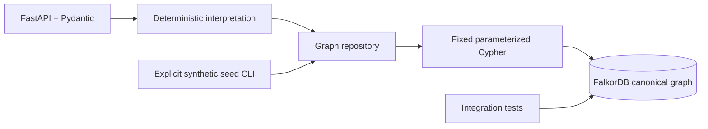

# Historical Phase 1–4 API and operator reference

This preserves the Phase 4 README. Use the current root README and Phase 5A gates for release status. Historical provider setup is not authorization for a remote call.

# RippleProof AI

An explainable supply-chain disruption agent for **Graph Hacks 2026, Track 1:
Agents That Act on Connected Data**. Team MORVE; one human participant.

This repository implements the **graph foundation, deterministic material engine,
Phase 3 MCP/agent/internal-decision workflow, and Phase 4 responsive frontend**. FalkorDB is the canonical store.
Dependency reachability and material risk are distinct. The model chooses read-only
tools; the deterministic engine calculates quantities, qualifications and cost.

**Phase 4:** open [the local workspace](http://127.0.0.1:18080). See Phase 4 verification (historical local artifact; excluded from public candidate) and the three-minute demo (historical local artifact; excluded from public candidate). Existing data is preserved; no reseeding is needed.

**Phase 3 verification:** see the executed results (historical local artifact; excluded from public candidate),
including the retained 103 Phase 2 tests, real MCP subprocess interaction, approval
and persistence checks. **Real paid-provider verification is pending operator
authorization and credentials.** Guided mode is explicitly labeled and calls no
model. Mock-provider tests are not represented as real LLM calls. Historical
Phase 2 (historical local artifact; excluded from public candidate) and Phase 1 (historical local artifact; excluded from public candidate)
records remain available.

## Start with Docker (Windows PowerShell)

Prerequisites: Docker Desktop running in Linux container mode with Docker Compose.
No host Python or API key is needed for the container workflow.

```powershell
# Run from the root of the extracted repository.
docker version
docker compose version
docker compose up --build -d
docker compose ps

# Existing Phase 2/3 graph: no seed or migration is needed.
$base = 'http://127.0.0.1:18000'
Invoke-RestMethod "$base/health"
Invoke-RestMethod "$base/api/graph/summary" | ConvertTo-Json -Depth 12
Invoke-RestMethod "$base/api/impact-paths?supplier_id=S-04" | ConvertTo-Json -Depth 20
Invoke-RestMethod "$base/api/alternatives?part_id=P-22&as_of=2026-10-15" | ConvertTo-Json -Depth 20
```

For a **fresh empty demo database only**, first run
`docker compose exec backend python -m rippleproof.seed`, then
`docker compose exec backend python -m rippleproof.migrate`. The base seed restores its synthetic fixture properties; use the
additive migration for existing graphs and preserve any operator edits.

The frontend is published at `127.0.0.1:18080`, the API at
`127.0.0.1:18000`, and FalkorDB at `127.0.0.1:6379`.
Port 8000 is reserved by Windows on the implementation machine. The container
still listens on its internal port 8000. OpenAPI is available at
[the local API docs](http://127.0.0.1:18000/docs) while the backend runs.

Optional configuration: copy `.env.example` to `.env` **only if `.env` does not
already exist**, then edit its port or graph settings. Compose works without it.
The backend's container connection always uses the Compose service name and
internal port; `FALKORDB_HOST` and `FALKORDB_PORT` also support host-side Python.

```powershell
if (-not (Test-Path .env)) { Copy-Item .env.example .env }
```

Data persists in the Compose `graph-data` named volume mounted at
`/var/lib/falkordb/data`, with AOF enabled. The complete graph was verified
unchanged after restarting and recreating the containers without reseeding.
`docker compose down` stops/removes containers while preserving that volume.
The included FalkorDB browser is not published. This local development stack has
unauthenticated reads and optional token-protected internal approvals. It is
intended for synthetic data on localhost, using one backend worker.

## Frontend workspace (Phase 4)

The Compose frontend serves a production React/TypeScript build through unprivileged
Nginx. It proxies `/api`, `/health` and `/openapi.json` to the existing backend on
the same origin. Open [Overview](http://127.0.0.1:18080/#/overview),
[Scenario Workbench](http://127.0.0.1:18080/#/workbench), or
[Decision Ledger](http://127.0.0.1:18080/#/decisions).

The workbench calculates real baseline/disruption/recovery plans, shows a scoped
Cytoscape evidence path with keyboard source controls, and explains alternatives
per part and projected arrival. Tablet layouts use a material inspector drawer;
mobile uses stacked results, a vertical evidence chain, expandable constraints
and a persistent scenario action. Result counts and money are never preloaded.

Guided tools execute the actual MCP sequence with zero model calls. This interface
has no remote-agent invocation control. A complete, recalculated internal-decision
preview comes before any manual authorization. The live ledger may be empty.
Approval remains optional and unavailable until an operator configures the backend
secret using the existing Phase 3 instructions. On trusted localhost only, paste
that secret into the transient password field, review the plan, and type
`APPROVE INTERNAL`. It clears per attempt, close and navigation. No token enters
browser storage, URLs, frontend environment variables or a model tool. Browser
approval is disabled on non-loopback origins. This is a local synthetic demo,
not production authentication; one backend worker and serialized external graph
writers remain required. No purchase, reservation or supplier contact occurs.

For development with the Compose backend running (Node 22.12+; Node 24 tested):

```powershell
# Stop the web container to free 18080; leave backend and database running.
docker compose stop frontend
Set-Location frontend
npm ci
npm run dev
# Open http://127.0.0.1:18080 ; Ctrl+C stops Vite.
```

Frontend verification from the repository root:

```powershell
.\scripts\verify_phase4.ps1
Set-Location frontend
npx playwright install chromium
npm run test:e2e
```

The check script runs TypeScript, ESLint, Prettier, Vitest, production build,
`npm audit`, Ruff, Python dependency validation and Compose checks. Run the full
backend suite separately using the existing test commands below. E2E requires
the running production frontend at 18080, real FalkorDB, a Python `.venv` with
`requirements-dev.txt`, and free local test ports 18001/18081. The suite creates
new isolated `test_rippleproof_p4ui_*` graphs and retains them for audit. It never
approves against the live `rippleproof` graph. One browser test stops/starts only
the Compose backend, with recovery in a `finally` block. No volumes are removed.
Test traces/HAR/video are disabled to keep authorization attempts out of logs.
Private test credentials/control state remain under ignored `.local`.

`npm run contracts` regenerates 41 Zod response/request validators and inferred
TypeScript types from the live OpenAPI. History has no typed OpenAPI response;
its explicit validator is checked against real empty and populated history.
Component tests use clearly separated mocks; browser acceptance runs actual
HTTP, deterministic calculations, MCP subprocess tools and FalkorDB persistence.
See the verification report (historical local artifact; excluded from public candidate) for exact results,
screenshots, security limits and pending provider/human-demo gates.

## API contracts

| GET endpoint | Meaning | Success / empty behavior |
| --- | --- | --- |
| `/health` | Checks `GRAPH.LIST` and, when present, a read query against the selected graph | 200 ready even before seeding, with `graph_exists: false` |
| `/api/graph/summary` | Actual node and relationship counts | 200 with zeros for an absent or empty graph |
| `/api/impact-paths?supplier_id=S-04` | Three-hop paths from primary supply to open orders | 200; existing supplier without dependencies returns empty `paths` and `order_ids` |
| `/api/alternatives?part_id=P-22&as_of=2026-10-15` | Non-primary offers, stored terms, required certs, holdings and expiry checks | 200; existing part without alternatives returns empty `candidates` |

Malformed/missing IDs or dates return 422. Supplier IDs use `S-` plus 2–5
digits, and part IDs use `P-` plus 2–5 digits. `as_of` is required and must be
an exact `YYYY-MM-DD` calendar date. Unknown query parameters are rejected.
A well-formed nonexistent supplier/part returns 404. Connection failures return
503; graph command/evidence errors return 500 and are logged. No data fallback
is used when the database is unavailable.

Observed response during a controlled stop of the real FalkorDB service:

```http
HTTP/1.1 503 Service Unavailable
Content-Type: application/json

{"error":{"code":"database_unavailable","message":"FalkorDB is unavailable. Try again later."}}
```

Observed `/health` body with HTTP 503:

```json
{"status":"unavailable","database":"unavailable","graph":"rippleproof","graph_exists":null}
```

Observed `/health` body with HTTP 200 after recovery and container recreation:

```json
{"status":"ready","database":"ready","graph":"rippleproof","graph_exists":true}
```

The following summary was captured from the running, seeded FalkorDB through
the HTTP API. Both additive migration runs returned these same counts:

```json
{
  "graph": "rippleproof",
  "node_count": 145,
  "relationship_count": 291,
  "nodes_by_label": {
    "Supplier": 12, "Part": 16, "Product": 8, "Order": 24,
    "Certificate": 3, "Decision": 0, "Evidence": 0, "InboundShipment": 82
  },
  "relationships_by_type": {
    "SUPPLIES": 24, "USES": 24, "CONTAINS": 29,
    "REQUIRES_CERT": 17, "HOLDS_CERT": 33,
    "SELECTS": 0, "AFFECTS": 0, "SUPPORTED_BY": 0, "FULFILLS": 82, "FOR_PART": 82
  }
}
```

Impact responses contain `analysis_type: "dependency_only"`, sorted unique
`order_ids`, and individual paths. Every path contains the order quantity,
units per product, their deterministic product, and connected evidence nodes
and relationships from the same graph path query. Stored edge direction is
preserved even when traversal runs backwards. The verified acceptance path is:

```text
Supplier S-04 -[SUPPLIES]-> Part P-22 <-[USES]- Product PR-05 <-[CONTAINS]- Order O-101
```

Alternative responses contain the part, required certificate nodes/edges and
candidates with `supply_terms`, the `supplies_relationship`, `certificate_checks`,
and `certifications_valid`. Each check is `valid`, `expired`, or `missing`, with
the requirement edge and an actual holding edge (or `null` when absent).
Expiry is inclusive: a certificate valid until 2026-10-15 passes on that date.
Validity is limited to the modeled requirements; no capacity or arrival
assessment is implied. Costs are synthetic units, not real quotations.

Verified synthetic fixtures include S-09 with valid P-22 certificates, cheaper
S-10 missing C-02, S-11 with expired C-02, and S-08 whose C-02 expires exactly
on the reference date. S-12 has no dependency paths. The S-04 HTTP response
contains 20 paths to 11 distinct open orders. For O-101/PR-05/P-22, the graph
returns order quantity 8 and 4 part units per product, giving path demand 32.
These are dependency facts, not a shortage or delay prediction.

## Phase 2 simulation

The scenario endpoint reads the current graph; it writes no proposals or
decisions and places no purchases. Example PowerShell request:

```powershell
$scenario = @{
    supplier_id = 'S-04'
    as_of = '2026-10-15'
    outage_start = '2026-10-16'
    outage_end_exclusive = '2026-10-24'
    include_mitigation = $true
} | ConvertTo-Json
$result = Invoke-RestMethod 'http://127.0.0.1:18000/api/scenarios/simulate' `
    -Method Post -ContentType 'application/json' -Body $scenario
$result | Select-Object scenario_id, dependent_orders, baseline_at_risk_orders, `
    disrupted_at_risk_orders, newly_at_risk_orders, restored_orders, `
    estimated_additional_procurement_cost | ConvertTo-Json -Depth 8
```

Observed response projection from the real API:

```json
{
  "scenario_id": "SC-4990e7e493adea7efa18",
  "baseline_at_risk_orders": ["O-122", "O-123"],
  "disrupted_at_risk_orders": ["O-105", "O-106", "O-123"],
  "newly_at_risk_orders": ["O-105", "O-106"],
  "restored_orders": ["O-105", "O-106"],
  "estimated_additional_procurement_cost": "1364.00",
  "incomplete_data": false
}
```

There are 11 dependent orders. Of 21 open orders, the baseline covers 19,
disruption covers 18, and selected mitigation covers 20. O-101 remains covered
using existing stock and unaffected receipts. O-122's baseline shortage is not
mislabeled as newly caused by the outage; global all-or-nothing allocation can
release stock to another order when an earlier order fails.

The selected new procurement schedule is:

| Supplier / part | Units | Dispatch | Arrival | Additional cost |
| --- | ---: | --- | --- | ---: |
| S-09 / P-22 | 27 | 2026-10-15 | 2026-10-18 | 391.50 |
| S-10 / P-12 | 70 | 2026-10-15 | 2026-10-17 | 630.00 |
| S-10 / P-12 | 30 | 2026-10-16 | 2026-10-18 | 270.00 |
| S-09 / P-22 | 5 | 2026-10-15 | 2026-10-18 | 72.50 |

S-10 is rejected for P-22 because it lacks C-02, but qualifies for P-12's C-01
requirement. S-11's P-22 certificate has expired. S-08 is valid at the as-of
date but rejected for P-22 because C-02 expires before its October 20 arrival.
The legacy alternatives endpoint checks the requested as-of date; the scenario
endpoint checks each **proposed arrival date**.

The response includes all per-order BOM lines, actual graph paths, allocated
receipt quantities, remaining lot balances, late receipt evidence, shipment
timing changes, candidate rejection codes and compared heuristic plans.
Full captured JSON is in
the actual demo response (historical local artifact; excluded from public candidate).

Orders sort by earliest deadline, higher numeric priority, then lexical ID.
Stock is shared globally and committed only when an entire order's BOM is
covered. Planned dispatches within the exclusive outage window move to its
end with transit duration preserved. Already dispatched and cancelled facts
remain distinct. New proposals respect booked per-part daily capacity and lead
days; every required certificate must cover arrival, inclusive.

All monetary computation uses Decimal and serializes prices/costs as strings.
The estimate is **gross additional procurement**, excluding committed costs,
cancellation fees, tax, labor and transport. The planner compares deterministic
greedy policies; it does not prove a global optimum. This is materials-only
deadline feasibility, not factory scheduling or a real delivery guarantee.
Vital missing/invalid data yields `incomplete_data` and affected orders marked
`insufficient_data`; no infinite stock, capacity or qualifications are assumed.
Set `include_mitigation` to false to return only baseline/disrupted plans.

The POST returns 422 for invalid bodies/windows/dates, 404 for unknown suppliers,
and 503 when FalkorDB is unavailable. Every simulation uses a fresh coherent
graph snapshot. Requests never create shipment or scenario nodes.

## Phase 3 MCP, agent and internal decisions

Phase 3 usage and the keyboard-friendly three-minute walkthrough are documented
in DEMO_PHASE3.md (historical local artifact; excluded from public candidate). The new endpoints are:

| Endpoint | Behavior |
| --- | --- |
| `POST /api/agent/run` | `mode: guided` calls actual MCP tools without a model; `mode: agent` requires explicit provider opt-in and credentials |
| `POST /api/decisions/prepare` | Fresh graph-derived preview of the selected policy, full quantities, certificate checks, cost and revision; writes nothing |
| `POST /api/decisions/approve` | Requires human confirmation, Bearer approval token, idempotency key and expected scenario/fingerprint/plan revision; writes an internal decision |
| `GET /api/decisions/{decision_id}` | Retrieves the durable decision and preview from FalkorDB |
| `GET /api/decisions?scenario_id=SC-...&offset=0&limit=5` | Paged internal approval history |

Memory writes leave the operational fingerprint and scenario ID unchanged.
Source changes invalidate previews (409). Same-key/same-request replay returns
the original record, even after source changes; same-key/different-request
conflicts (409). An internal approval never changes stock, order status or
inbound bookings, and never contacts a supplier or places a purchase.

Run the **real MCP SDK client/server smoke test**:

```powershell
docker compose exec -T backend python -m rippleproof.mcp_smoke
```

The stdio server entrypoint is `python -m rippleproof.mcp_server`. External MCP
clients can spawn `docker compose exec -T backend python -m rippleproof.mcp_server`
from the repository directory. The registry is limited to `graph_summary`,
`trace_supplier_impact`, `evaluate_part_alternatives`, `simulate_supply_disruption`,
`get_decision_history`, and `resolve_evidence`. There is no approval, raw Cypher,
filesystem, network-fetch or command-execution tool. Structured results are capped
at 32 KiB; paged tools expose total/next-offset/truncation, and oversized critical
simulation results fail explicitly. Evidence can be resolved with a matching
operational fingerprint.

The default agent request uses explicitly supplied scenario fields. Missing
scenario fields produce `needs_input`; the coordinator never guesses dates from
an ambiguous question. Agent mode can select any registry tool within six model
turns/eight tool calls by default. Only validated citations/scenario selections
are accepted from the model; the answer's factual text is rendered from computed
simulation results. Fabricated prices, quantities, certification fields or refs
are rejected and visibly replaced with the verified structured result.

Remote provider calls require **all** of these local settings:

```dotenv
RIPPLEPROOF_PROVIDER=openai
RIPPLEPROOF_ALLOW_PAID_CALLS=true
RIPPLEPROOF_OPENAI_MODEL=<operator-selected available model supporting tools and structured output>
RIPPLEPROOF_OPENAI_API_KEY=<operator-supplied secret>
```

These settings configure backend capability; they do not authorize a remote or
billable call. Follow the current [separate human gate](AGENT_DEMO_GATE.md).
No remote call was made during implementation. Keep secrets only in the ignored `.env` or
process environment; never commit or paste them into questions, traces or logs.
Restart/recreate the backend after configuration changes. The fixed provider
endpoint is OpenAI Responses; retries are disabled, responses are bounded and
`store` is false. Provider authentication/transport/timeout errors remain visible.
See the official [function-calling guide](https://developers.openai.com/api/docs/guides/function-calling)
and [MCP Python SDK](https://github.com/modelcontextprotocol/python-sdk).

Human approval setup and an explicit confirmation prompt are in the walkthrough.
The approval secret is separate from provider credentials and never sent to MCP
or the model. The API does not prove a person's identity beyond possession of
the demo token and explicit confirmation. Keep the one-worker localhost setup;
serialize CLI/external graph edits against approvals. The source check and write
are separate commands; there is **no server-side compare-and-write transaction**
excluding external writers. Do not deploy this demo as a public approval service.

## Automated checks

The full container test workflow builds its own test target and queries the real
Compose FalkorDB server. Integration tests use isolated, randomly named
`test_rippleproof_*` graphs and remove only the graphs they create.

```powershell
docker compose --profile test build tests
docker compose --profile test run --rm tests
```

Host workflow, Python 3.12+ (3.12.15 in Docker and 3.14.0 on Windows were tested):

```powershell
python -m venv .venv
.venv\Scripts\python -m pip install -r requirements-dev.txt
.venv\Scripts\python -m pytest -q -m 'not integration'
.venv\Scripts\python -m ruff check .
.venv\Scripts\python -m ruff format --check .

# Requires the real server from docker compose up:
.venv\Scripts\python -m pytest -q -m integration
```

Plain `pytest` selects all tests. Database-dependent tests fail clearly if
FalkorDB is unavailable; they do not silently skip or mock the server.
Coverage includes seed repeatability and property restoration, genuine
three-hop evidence, alternatives and expiry boundaries, unknown entities,
empty graph, empty results, repeated reads, graph mutations changing answers,
strict inputs, and real refused TCP connections returning 503.

To run the API from the host with a reachable FalkorDB:

```powershell
.venv\Scripts\python -m rippleproof.migrate
.venv\Scripts\python -m uvicorn rippleproof.app:app --host 127.0.0.1 --port 18000
```

## Architecture and files



| Files | Responsibility |
| --- | --- |
| `rippleproof/app.py`, `models.py`, `config.py`, `errors.py` | HTTP contracts, configuration and visible failures |
| `rippleproof/repository.py`, `queries.py` | Official client, reviewed queries and operation-scoped connections |
| `rippleproof/service.py`, `evidence.py` | Certificate checks, demand multiplication and graph evidence serialization |
| `rippleproof/seed_data.py`, `seed.py` | Fixed reference date/PRNG and idempotent CLI writes |
| `rippleproof/inbound_data.py`, `migrate.py` | Additive planned-receipt fixture and migration |
| `rippleproof/simulation/` | Normalized snapshot, typed contracts, shared allocator and mitigation |
| `Dockerfile`, `compose.yaml`, `.dockerignore`, `.env.example` | Runtime/test containers, localhost ports and graph persistence |
| `requirements.txt`, `requirements-dev.txt`, `pyproject.toml`, `.gitignore` | Pinned dependencies and development checks |
| `tests/` | Local behavior tests and real-server integration tests |
| `docs/ARCHITECTURE.md`, `docs/PHASE1_VERIFICATION.md` | Query/security decisions, limitations, commands and actual results |

See the authoritative product spec (historical local artifact; excluded from public candidate),
graph schema (historical local artifact; excluded from public candidate), and
architecture/query walkthrough (historical local artifact; excluded from public candidate).

## AI-assistance disclosure

OpenAI Codex assisted with Phases 1–4 implementation, synthetic data, tests,
documentation and local verification during the event on 2026-10-15/16.
The human participant is responsible for reviewing and understanding the work
and submitting the competition disclosure. Test claims are limited to the
recorded executed checks. MCP, bounded model orchestration and internal decision
approval are implemented. A real remote-provider smoke run remains unexecuted.
The frontend calls real graph-backed APIs. No enterprise integration or real
procurement action is implemented; guided MCP mode makes zero model calls.

Phase 4 stops at its documented gates. No Phase 5 work or GitHub push.
Before a public release, export only reviewed project sources: exclude `.venv`,
`.git`, `.local`, all `.env` secrets, raw workstation logs and the oversized
historical Phase 2 response. Preserve local originals and backups. The Phase 3
verification artifacts contain synthetic graph data and no approval/provider token.
